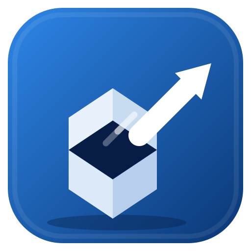

<p align="center">
  
</p>

# PS5 Package Sender

[](https://github.com/AldySan/ps5-package-sender/actions/workflows/build.yml)
[](https://github.com/AldySan/ps5-package-sender/releases)
[](#getting-started)
[](#built-with)
[](LICENSE)

A portable desktop tool that puts games, updates and extra content on a
jailbroken PS5 over your home network. It sends `.pkg` and `.fpkg` packages
for the console to install, and copies disc images (`.exfat`, `.ffpkg`,
`.ffpfs`, `.ffpfsc`) straight to a folder the console scans. No USB drives,
no FTP, nothing to install on the PC.

It is built with C++17, Qt 6 and SQLite, and ships as a portable download
for **Windows** and **Linux**: unpack it anywhere and run it. Settings, the
library cache and the transfer history live in a `data` folder next to the
executable, so the app leaves nothing behind elsewhere on your system.

## How it works

1. The console runs [pkg-receiver.elf](https://github.com/AldySan/ps5-package-receiver-elf)
   (grab it from that project's releases and load it with your usual payload
   loader). It listens on port `12800` and announces itself on the LAN.
2. This app finds the console automatically, serves packages from a local
   HTTP file server (port `9898`, byte-range capable) and pushes install
   tasks to the receiver, and the console downloads and installs through
   Sony's own installer.
3. Disc images are copied straight into a folder your console-side mounter
   scans, with live progress, pause and resume.

## Features

- **Zero-config networking:** UDP beacon discovery with a LAN sweep
  fallback, PC address selection that prefers the network the console sits
  on, live receiver status with build and free space readout
- **Library:** scan folders or drop files and folders onto the window; PKG
  metadata (title, title ID, version, cover art, header digest) is parsed
  straight from the package header, and updates and DLC stay grouped with
  their base game
- **Send queue:** per-item progress with pause, cancel and retry, a
  one-click retry for every failed row, rows you can reorder while they
  wait, and a record of every finished item in the transfer history
- **Scan-path destinations:** image copies can target any folder the
  console mounter scans: `/data/homebrew`, `/data/etaHEN/games`,
  `/mnt/ext0`/`/mnt/ext1`, `/mnt/usb0` to `/mnt/usb7` (and their
  `homebrew` or `etaHEN/games` subfolders), `/mnt/shadowmnt`, or any custom
  path that matches your [ShadowMountPlus](https://github.com/drakmor/ShadowMountPlus)
  `scanpath` configuration
- **Share to console:** while enabled, the library is published as a
  catalog the receiver's web page can browse, with covers and install
  buttons

## Getting started

### On the console

Jailbreak your PS5 and load
[pkg-receiver.elf](https://github.com/AldySan/ps5-package-receiver-elf)
with the payload loader you normally use. With etaHEN, dropping the file
into `/data/etaHEN/payloads/` is enough. Wait for the *listening on port
12800* notification. That is the only console-side setup.

### On the PC

1. Download the latest portable archive for your OS from the
   [Releases](../../releases) page and unpack it anywhere.
   - Windows: unzip and run `ps5-package-sender.exe`
   - Linux: `tar -xzf` and run `./run.sh`
2. Put the PC and the console on the same network. A direct Ethernet cable
   with manual addresses on both ends also works; avoid link-local
   auto-assignment.
3. Press **Detect**. Pick the console from the list, or type its IP and
   press **Test**.
4. **+ Add folder** (or drag packages onto the window), select what you
   want and press **Send PKG**. Disc images use **Copy images**: pick the
   destination from the scan-path list first.

## Using the app

The top bar switches between four pages, and the status bar underneath
shows the receiver state, free space, the PC address and the share toggle.

- **Library** lists everything you added. Use **+ Add folder**, **+ Add
  PKG files** or plain drag and drop, search by title or ID, select items,
  then press **Send PKG** or **Copy images**.
- **Queue** shows each transfer with live progress. Pause, resume, cancel
  or retry a single row, move rows up and down while they wait, or use
  **Retry failed** and **Clear finished** for the whole list.
- **History** records every finished install and copy with its outcome,
  and can be cleared whenever you like.
- **Settings** holds the appearance, connection, scan-path and update
  options described in [Settings and data](#settings-and-data).

While **Share to console** is on, the status bar shows the catalog
address. Open `http://<console-ip>:12800` in the console's browser (the
receiver's web page) to browse your library with covers and start installs
from the console itself.

## Troubleshooting

**Detect finds no console.** Make sure the receiver ELF is really running
(look for the *listening on port 12800* notification on the console) and
that both devices sit on the same network. Then check the PC firewall: the
app needs inbound connections on port `9898` (it also tries `9899` to
`9907`). On Windows, allow it on private networks when prompted.

**The receiver shows offline, but the console is on.** Type the console IP
manually and press **Test**. If the PC has several adapters (VPN, virtual
machines), pick the address that actually reaches the console from the PC
list in the status bar.

**Transfers are slow.** Wi-Fi limits both directions; connect the PC and
the console with Ethernet cables if you can.

**A copied image does not show up on the console.** The destination has to
be a folder the console-side mounter actually scans. Compare it against
the scan-path list in the app, or add the exact path from your mounter
configuration as a custom path. The mounter scans on its own schedule, so
give it a moment after the copy finishes.

**Want a clean slate?** Everything the app remembers lives next to the
executable (see [Settings and data](#settings-and-data)). Delete that
folder and it starts fresh.

## Settings and data

Everything the app remembers (settings, library cache, transfer history,
custom scan paths) is kept in `data/store.db` next to the executable. Set
`PS5PKGSENDER_DATA_DIR` to override the location.

The Settings page offers:

- **Appearance:** dark or light theme, plus five accent colors. The choice
  is remembered.
- **Connection:** the console IP, and the PC address the app advertises
  when several adapters are present.
- **Scan paths:** the destinations offered by **Copy images**, including
  custom paths from your mounter configuration.
- **Updates:** an automatic check for a newer release at startup, and a
  manual **Check for updates** button.

## Project structure

| Path | What lives there |
| --- | --- |
| `src/` | C++ backend: queue and transfers, receiver client, file server, discovery, library, SQLite storage |
| `qml/` | Qt Quick interface: pages, reusable controls, theme |
| `tests/` | Console test binaries run by CTest |
| `resources/` | App icon in several formats |
| `scripts/` | Linux portable bundling script |
| `.github/` | CI workflows, issue templates and pull request template |
| `DESIGN.md` | Design direction and accessibility floor |

## Built with

- C++17 for the core logic
- Qt 6 (Quick / QML) for the interface, networking and storage
- SQLite as the embedded store for settings, library and history
- CMake for the build, GitHub Actions for CI and releases

## Building from source

Requires Qt 6.5 or newer (Quick, QuickControls2, Sql, Network, Concurrent,
Svg), CMake 3.21+, and a C++17 compiler.

```sh
cmake -B build -DCMAKE_BUILD_TYPE=Release -DBUILD_TESTS=ON
cmake --build build
ctest --test-dir build --output-on-failure
```

CI builds and tests Windows and Linux on every pull request that targets
`dev`. Pushing a `v*` tag publishes the portable archives as a GitHub
release.

## Contributing

Bug reports and pull requests are welcome. New to open source?
[CONTRIBUTING.md](CONTRIBUTING.md) walks you through the whole process,
from fork to pull request. All participation is covered by the
[Code of Conduct](CODE_OF_CONDUCT.md).

## Support development

If PS5 Package Sender is useful to you, there are a few easy ways to
support it:

- **Give the repository a ⭐ Star** on GitHub. It takes a second and helps
  other PS5 owners find the tool.
- **Share it** with friends or communities who might need it.
- **Support development on [Ko-fi](https://ko-fi.com/aldysan)** if you
  want to chip in for coffee and hosting.

Every one of these is appreciated, and none of them is expected. The tool
stays free either way.

## License

GPL-3.0. See [LICENSE](LICENSE).
